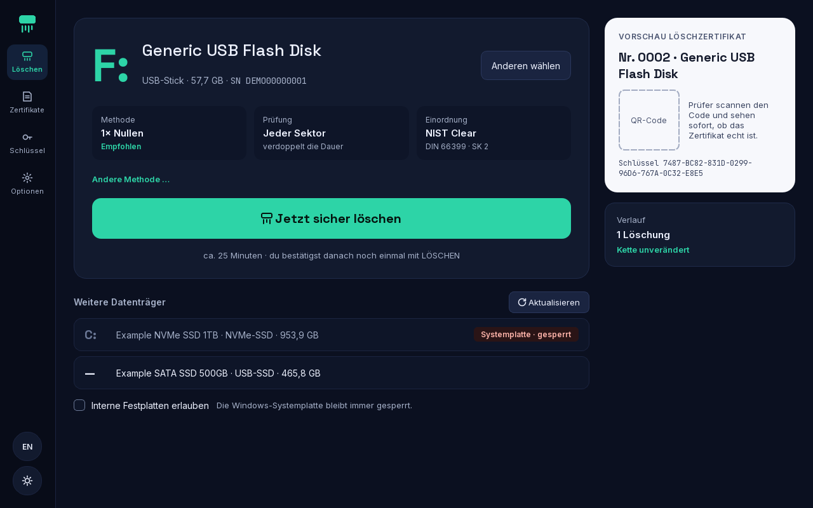
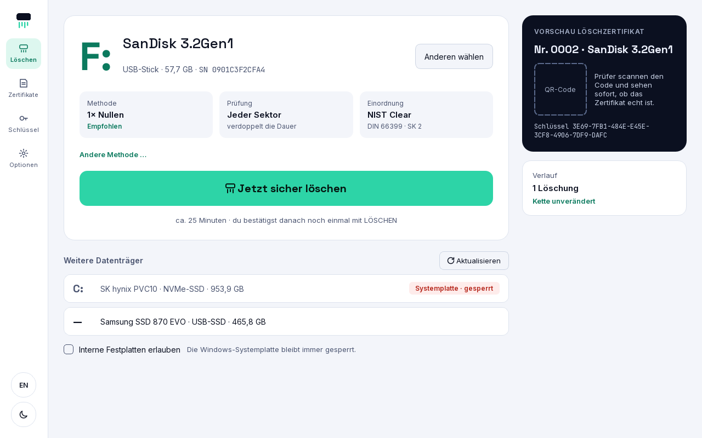
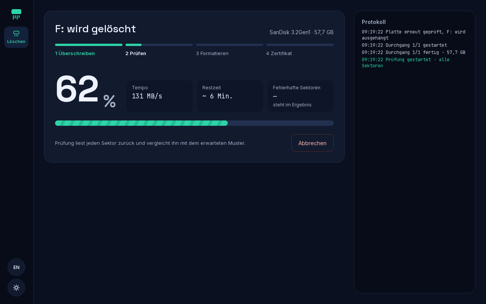
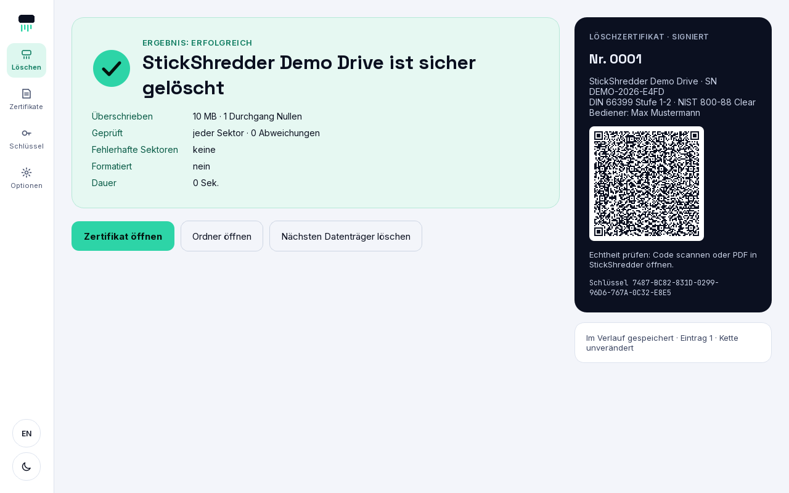
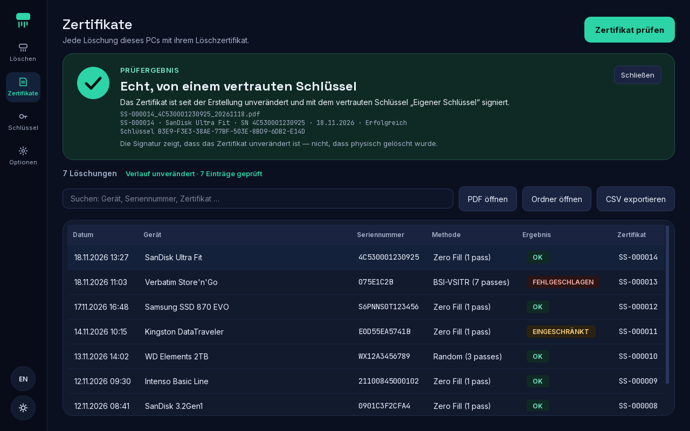
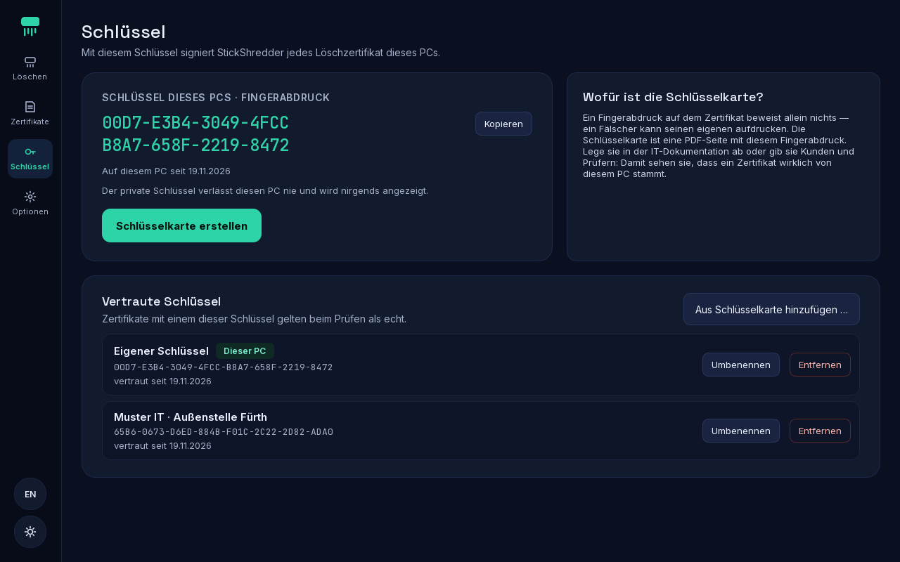
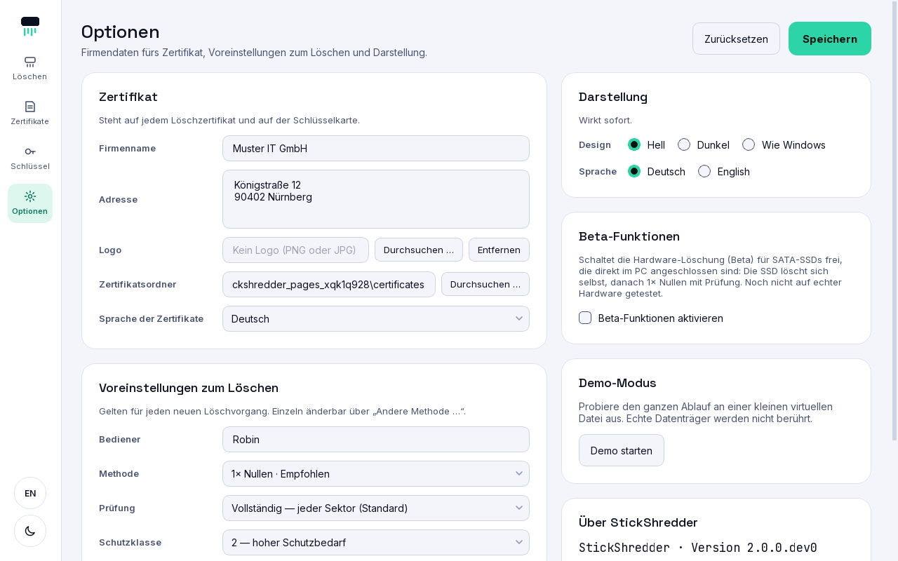
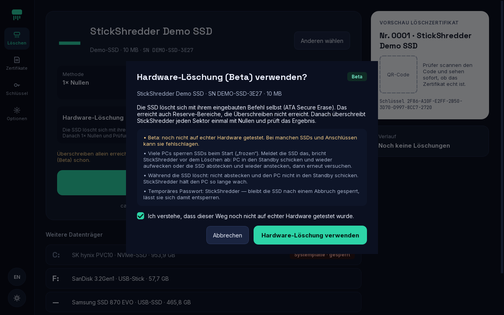
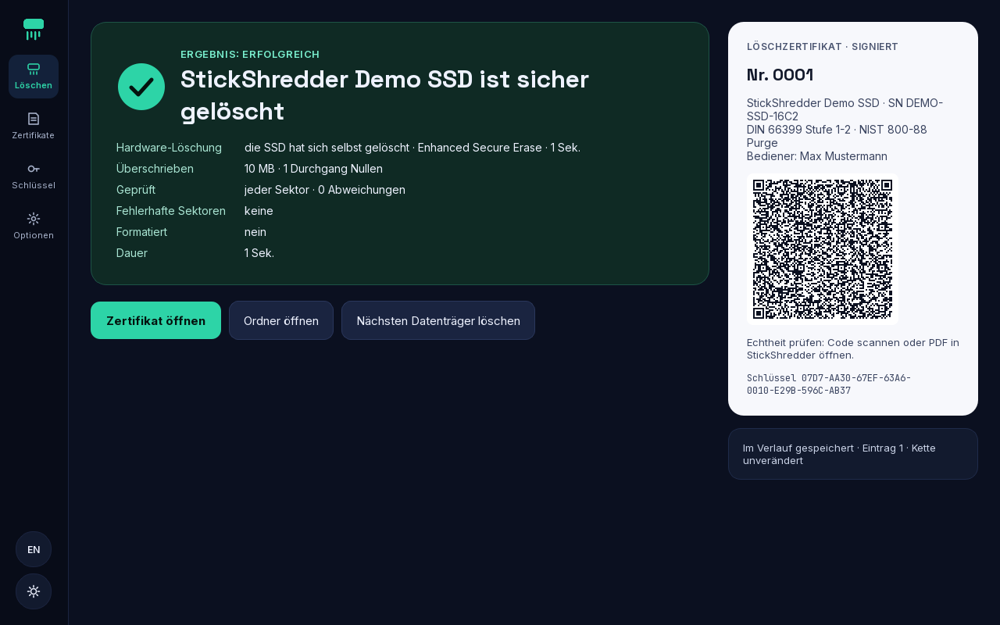

<h1 align="center">StickShredder</h1>

<p align="center"><strong>Wipe USB sticks and disks on Windows — with a signed deletion certificate you can check</strong></p>

<p align="center">
  <a href="LICENSE"></a>
  
  
</p>

<p align="center">
  
</p>

**[Deutsche Version weiter unten ↓](#deutsch)**

---

## Contents

- [What it is](#what-it-is)
- [Screenshots](#screenshots)
- [Download and install](#download-and-install)
- [Quick start (GUI)](#quick-start-gui)
- [CLI reference](#cli-reference)
- [Wipe methods and verification](#wipe-methods-and-verification)
- [Recommendations](#recommendations)
- [Hardware erase (Beta)](#hardware-erase-beta)
- [What the certificate proves — and what it doesn't](#what-the-certificate-proves--and-what-it-doesnt)
- [Tested hardware](#tested-hardware)
- [Limitations](#limitations)
- [FAQ](#faq)
- [Build from source](#build-from-source)
- [Licence](#licence)
- [Deutsch](#deutsch)

---

## What it is

StickShredder is a free, open-source Windows program (GUI and command line) that overwrites a USB stick, SD card or disk sector by sector, reads every sector back to check the result, and writes a PDF deletion certificate. The certificate is laid out along DIN 66399 / ISO 21964 terms (protection class, security level) and names the NIST SP 800-88 category; it is signed with a key that belongs to your installation, so anyone can check later that it was not changed. It runs on normal Windows — no boot stick, no reboot — and works fully offline. It is built for IT admins in small companies who need to document how data carriers were wiped. **StickShredder is not certified by DEKRA, DIN, BSI or anyone else** — see [what the certificate proves](#what-the-certificate-proves--and-what-it-doesnt).

---

## Screenshots

All screenshots show demo data (made-up disks, a demo wipe of a 10 MB file).

<table>
  <tr>
    <td width="50%"><br><sub><b>Löschen</b> — pick a disk; method, verification and classification are pre-set to the recommendation. The Windows disk is locked.</sub></td>
    <td width="50%"><br><sub><b>Running</b> — overwrite, then every sector is read back. Speed, time left, log.</sub></td>
  </tr>
  <tr>
    <td><br><sub><b>Result</b> — three-level result and the signed certificate with QR code and key fingerprint.</sub></td>
    <td><br><sub><b>Zertifikate</b> — wipe history, chain status, and checking a certificate PDF.</sub></td>
  </tr>
  <tr>
    <td><br><sub><b>Schlüssel</b> — this PC's signing key, key card, trusted keys of other PCs.</sub></td>
    <td><br><sub><b>Optionen</b> — company data for the certificate, wipe defaults, Beta switch, demo mode.</sub></td>
  </tr>
  <tr>
    <td><br><sub><b>Hardware erase (Beta)</b> — extra confirmation before the SSD erases itself.</sub></td>
    <td><br><sub>Result of a hardware erase: the drive's own erase, then one pass of zeros and a full check.</sub></td>
  </tr>
</table>

More: [`docs/screenshots/v2/`](docs/screenshots/v2/) (every page in light and dark).

**Sample certificates** (signed, demo data, made with a throwaway key — so they check as *signature valid, key unknown*): [German](docs/examples/sample-certificate-2.0-de.pdf) · [German/English](docs/examples/sample-certificate-2.0-de-en.pdf).

---

## Download and install

Download from the [Releases](https://github.com/rctom16-bit/stickshredder/releases) page:

- **`StickShredder-<version>-Setup.exe`** — installer (needs administrator rights, installs to *Program Files*).
- **`StickShredder.exe`** — portable, runs without installing.

StickShredder needs **administrator rights** to write to a whole disk. The window asks for elevation (UAC) when started without them; if you decline, it warns you and wiping will not work. The command line does not ask — run it from an elevated terminal.

Your settings, wipe history, audit log, signing key and certificates live in `%USERPROFILE%\.stickshredder\` (certificates in `certificates\` unless you choose another folder).

---

## Quick start (GUI)

The window opens in German; the **EN** button at the bottom left switches to English.

1. **Once:** open **Optionen** and enter your company name, address and (optionally) a logo — they are printed on every certificate. Then open **Schlüssel** and click **Schlüsselkarte erstellen** (create key card). Print the key card, sign it and file it with your IT documentation (see [below](#what-the-certificate-proves--and-what-it-doesnt)).
2. Plug in the stick. The disk list refreshes by itself when a USB device is plugged in or removed.
3. On **Löschen**, pick the disk (**Anderen wählen** / choose another). The Windows disk is shown as *Systemplatte · gesperrt* and cannot be selected. Internal disks only become selectable after ticking **Interne Festplatten erlauben** (allow internal disks).
4. The tiles show method, verification and classification, pre-set to the [recommendation](#recommendations). **Andere Methode …** changes method, protection class, operator, verification and an optional reformat for this wipe.
5. Click **Jetzt sicher löschen** and type **LÖSCHEN** (English UI: **DELETE**) to confirm.
6. When it is done you see the result (*Erfolgreich*, *Mit Einschränkungen* or *Fehlgeschlagen*) and the signed certificate with **Zertifikat öffnen** (open certificate).

**Try it without a disk:** **Optionen → Demo-Modus → Demo starten** runs the whole flow on a small temporary file. Real disks are not touched.

---

## CLI reference

The same `StickShredder.exe` is the command-line tool when you pass arguments (from source: `python src\main.py <command>`). Run it in an elevated terminal. `stickshredder <command> --help` shows every option.

| Command | What it does |
|---|---|
| `list` | List detected disks with their safety status. |
| `info --device X [--schutzklasse N]` | Show model, type, drive letters, system/internal status and the recommended procedure. Reads Windows' device information only; the disk is not opened. |
| `wipe --device X --operator NAME [options]` | Wipe a disk and write a signed certificate. |
| `unlock --device X --experimental [--allow-internal] [--yes]` | Remove StickShredder's temporary drive password after an interrupted hardware erase (Beta). One try only. |
| `history [--export FILE] [--verify]` | Show the wipe history, export it as CSV, or check its hash chain. |
| `verify-cert PDF` | Check a certificate's signature. |
| `keycard [--output PATH] [--language de\|en\|both]` | Create the key card PDF for this installation's key. |
| `trust add KEY [--name NAME]` / `trust list` / `trust remove FINGERPRINT` | Manage trusted keys (from a key-card link, key-card PDF or base64url key). |
| `key export PATH` / `key import PATH` | Move the signing key to another PC (password-protected file; the password is asked for interactively). |

`--device` takes a drive letter (`E:`), a disk number (`2`) or `PhysicalDrive2`. Disks without a drive letter are listed by `list` with their `PhysicalDriveN` name.

**`wipe` options**

| Option | Default | Meaning |
|---|---|---|
| `--method zero\|standard\|bsi\|custom\|secure-erase` | the recommendation for the device | `zero` 1 pass of zeros · `standard` 3 random passes · `bsi` BSI-VSITR, 7 passes · `custom` · `secure-erase` = [hardware erase (Beta)](#hardware-erase-beta) |
| `--verify none\|sample\|full` | `full` | see [verification](#wipe-methods-and-verification) |
| `--schutzklasse 1\|2\|3` | `2` | DIN 66399 protection class on the certificate |
| `--operator NAME` | — (required) | operator on the certificate |
| `--client REF`, `--asset-tag TAG` | empty | client reference, asset tag or ticket number |
| `--passes N`, `--pattern zero\|ones\|random` | `3`, `random` | for `--method custom` |
| `--output-dir DIR` | from settings | certificate folder |
| `--language de\|en\|both` | from settings (`de`) | certificate language |
| `--reformat none\|fat32\|exfat\|ntfs` | `none` | create a partition and format after the wipe |
| `--reformat-label LABEL`, `--reformat-partition MBR\|GPT` | `USB`, `MBR` | label and partition style for `--reformat` |
| `--allow-internal` | off | allow internal (non-removable) disks; the Windows disk is always refused |
| `--experimental` | off | required for `--method secure-erase` |
| `--yes`, `-y` | off | skip confirmation prompts (scripting) |

`--enhanced` is still accepted for compatibility; the hardware erase uses the enhanced variant by itself when the drive offers it.

**Exit codes**

| Command | `0` | `1` | `2` | `3` |
|---|---|---|---|---|
| `wipe` | successful | failed | — | with limitations |
| `verify-cert` | genuine, key trusted | signature valid, key unknown | invalid, altered or unsigned | — |
| `history --verify` | chain unchanged | chain changed | — | — |

**Examples**

```bat
stickshredder list
stickshredder info --device E:

rem Recommended procedure: one pass of zeros + full verification
stickshredder wipe --device E: --operator "Max Mustermann"

rem With client reference, protection class 3, certificate in a given folder
stickshredder wipe --device E: --operator "Max Mustermann" --schutzklasse 3 --client "ACME GmbH" --output-dir "D:\Certificates"

rem Internal disk without a drive letter
stickshredder wipe --device PhysicalDrive2 --allow-internal --operator "Max Mustermann"

rem Hardware erase (Beta), SATA SSD connected directly
stickshredder wipe --device PhysicalDrive2 --method secure-erase --experimental --allow-internal --operator "Max Mustermann"

rem Reformat as exFAT afterwards
stickshredder wipe --device E: --operator "Max Mustermann" --reformat exfat --reformat-label ARCHIV

stickshredder verify-cert SS-000042_EXAMPLE_20261118.pdf
stickshredder history --verify
stickshredder keycard --language both
```

---

## Wipe methods and verification

| Method | CLI | Passes | Pattern | Security level on the certificate |
|---|---|---|---|---|
| **Zeros, 1 pass** (recommended) | `zero` | 1 | `0x00` | 1-2 |
| Random, 3 passes | `standard` | 3 | random data | 3 |
| BSI-VSITR, 7 passes | `bsi` | 7 | `0x00`/`0xFF` alternating, last pass random | 4+ |
| Custom | `custom` | your choice | zeros, ones or random | custom |

One pass is enough for today's media. The 3-pass and 7-pass methods are kept because some internal policies still require them; they are never recommended, and choosing them shows a note that they add time, not security.

**Verification** — after the overwrite, StickShredder reads the disk back:

| Mode | What it does | Time |
|---|---|---|
| `full` (default) | reads **every** sector and compares it with the expected pattern; lists the first 100 mismatching offsets | roughly doubles the run time |
| `sample` | checks 100 random sectors | a few seconds |
| `none` | no check (CLI only; the GUI always checks) | — |

Only full verification catches sectors that "silently fail" (the write reports success, but old data is still there when read back). For methods whose last pass is random, StickShredder adds one pass of zeros when verification is on, so the result can be compared byte by byte; the certificate shows the real number of passes.

**Bad sectors** — a sector that cannot be written because of a media error is skipped, counted and listed on the certificate; the wipe continues and ends *with limitations*. If more than 10 % of the disk cannot be written, the wipe fails. Any other write error (for example "access denied" because Windows mounted the disk again) stops the wipe as failed.

**Hidden areas (HPA/DCO)** — on SATA disks connected directly (Microsoft's own SATA driver), StickShredder asks the disk before wiping whether part of it is hidden from Windows (Host Protected Area, Device Configuration Overlay). Such areas cannot be overwritten. They are reported, never removed, and the result is *with limitations*.

**Reformat** — optionally, after the wipe StickShredder creates one partition over the whole disk and formats it (exFAT, FAT32 up to 32 GB, NTFS). If formatting fails, the wipe result and the certificate stay as they are.

**Three-level result** — the same in the GUI, CLI, history and certificate:

| Result | When | History `result` |
|---|---|---|
| **Erfolgreich / Successful** | wipe and verification passed | `OK` |
| **Mit Einschränkungen / With limitations** (GUI chip: *EINGESCHRÄNKT*) | unwritable sectors, a hidden area (HPA/DCO) that was not removed, or a hardware erase without verification | `LIMITED` |
| **Fehlgeschlagen / Failed** | the wipe failed, or the verification found differences | `FAILED` |

Older history files with `SUCCESS` / `FAILED` are still read correctly.

---

## Recommendations

StickShredder pre-selects a procedure by device type (Windows' media and bus type; no drive command is sent for this):

| Device | Recommendation | NIST SP 800-88 | Notes shown |
|---|---|---|---|
| Hard disk (HDD) | 1 pass of zeros + full verification | Clear | — |
| SSD | 1 pass of zeros + full verification | Clear | overwriting cannot reach the SSD's spare areas; protection class 3: destroy physically |
| SATA SSD connected directly, **Beta features on (GUI)** | hardware erase (Beta), then 1 pass of zeros + full verification | Purge | the hardware erase is recommended but you still have to choose and confirm it; protection class 3: destroy physically anyway (whether the drive's erase reached the spare areas cannot be checked from outside) |
| USB stick / SD card | 1 pass of zeros + full verification | Clear | protection class 3: destroy physically |
| Unknown type | 1 pass of zeros + full verification | Clear | residual data possible if it is an SSD or stick |

The protection class (Schutzklasse) is yours to choose — default 2. **Protection class 3 on an SSD, USB stick or SD card:** the Löschen page, the CLI and the certificate say that overwriting cannot reach the reserve areas and that the medium has to be destroyed physically — also after a hardware erase. In the CLI the recommendation never includes the hardware erase; `wipe` without `--method` uses the recommended overwrite and says so.

---

## Hardware erase (Beta)

**What it does.** Instead of only overwriting, StickShredder tells the SSD to erase itself with its built-in ATA Secure Erase command (the *enhanced* variant when the drive offers it). That also reaches spare and remapped flash cells an overwrite cannot address. Afterwards StickShredder writes one pass of zeros and reads back **every** sector — always, whatever verification you usually use — so the result does not rest on the drive's word alone. The certificate names both steps and the NIST category *Purge*.

**Only for SATA SSDs connected directly to the PC** (on Microsoft's own SATA driver). Not offered for:
- **SSDs in USB enclosures** — the USB bridge would have to pass the erase command through; StickShredder only sends read-only queries over USB bridges, by design.
- **NVMe SSDs** — NVMe has its own erase command (sanitize/format); it is not built yet.
- **Disks behind vendor RAID/VMD drivers** (e.g. Intel RST) and the Windows disk — they never receive drive commands. See [docs/hardware-safety.md](docs/hardware-safety.md).

**How to use it**
- **GUI:** **Optionen → Beta-Funktionen → Beta-Funktionen aktivieren** (off by default). Then a fitting SSD shows a *Hardware-Löschung* card on the Löschen page. An extra dialog explains the risks and needs a tick ("not tested on real hardware") before it can be used.
- **CLI:** `stickshredder wipe --device PhysicalDriveN --method secure-erase --experimental --allow-internal --operator "…"` (the CLI does not use the Beta switch; `--experimental` is the acknowledgement).

**Before it starts**, StickShredder asks the drive whether its erase is ready and stops — before anything is written — if the drive is *frozen* (many PCs lock SSDs at start-up: put the PC to sleep and wake it, or unplug and replug the SSD, then try again), already has a password, is locked, or does not support the command.

**While it runs:** the drive sets a temporary password, `StickShredder`, which is shown on screen and written to the audit log before it is set. Do not unplug the drive or let the PC sleep (StickShredder keeps it awake); this step cannot be cancelled. The command may take up to two hours, or twice the drive's own estimate.

**Unlock.** If an erase is interrupted, the SSD can stay locked with that password. **SSD entsperren …** (on the result and in the disk selection) or `stickshredder unlock --device X --experimental` removes it (SECURITY UNLOCK + DISABLE PASSWORD) — one try only, because every wrong try uses up one of the drive's few attempts.

> **Not tested on real hardware.** The maintainer has no PC with a SATA port. The procedure is built and tested against simulated drives only. Use it on drives you can afford to lose, and please report results.

---

## What the certificate proves — and what it doesn't

**Signature.** Every certificate is signed (Ed25519) with a key that StickShredder creates for your installation on first use. The private key is stored protected by Windows (DPAPI) and never shown; `key export` / `key import` move it to another PC in a password-protected file. The certificate carries a QR code and a verification code with the signed data (device, serial number, method, result, verification, operator, company, history hash …), and the same data as a PDF attachment (`stickshredder-certificate.json`). A valid signature proves two things: **the certificate has not been changed since it was created, and it was signed with this key.**

**Key card = trust anchor.** A fingerprint printed on a certificate proves nothing on its own — a forger can print their own. The key card is a one-page PDF with your company name, the key's fingerprint and a QR code. Sign it and file it with your IT documentation, or give it to customers and auditors. A certificate is trustworthy when its fingerprint matches the key card.

**Three verify levels** (GUI *Zertifikat prüfen*, `verify-cert`, and the verify page):

| Level | Meaning |
|---|---|
| **Genuine, from a trusted key** | signature valid and the key is in the trusted list |
| **Signature valid, key unknown** | unchanged since it was created, but compare the fingerprint with the key card before trusting it |
| **Invalid or altered** | do not trust this certificate |

**Verify page:** [`rctom16-bit.github.io/stickshredder/verify/`](https://rctom16-bit.github.io/stickshredder/verify/). Scan the certificate's QR code, paste the verification code, or drop the PDF on it. The check runs **entirely in the browser — nothing is uploaded** (the code sits after the `#` in the link, which browsers never send to the server). Scanning a key card's QR code once adds that key to the browser's trusted list.

**History chain.** Every entry in the wipe history contains a hash over the previous entry, so changing, deleting, inserting or reordering an entry breaks the chain from that point (`history --verify`, or the chain status on the Zertifikate page). The newest hash is also written into each signed certificate, which makes removing entries at the end visible too.

**What it does not prove.** The signature does **not** prove that the disk was physically erased. That is what the wipe log and the read-back verification on the certificate are for — and they are only as good as what the disk reports back to Windows (see [limitations](#limitations)). The certificate is *laid out along* DIN 66399 / ISO 21964 terms; StickShredder is **not certified** by DEKRA, DIN or any other body, and the certificate footer says so. It is documentation for internal audits, not a legal compliance proof.

---

## Tested hardware

Only runs on real hardware are listed. If you test StickShredder on your own device, please open an issue with the results.

| Device | Connection | Method | Version | Date | Result |
|---|---|---|---|---|---|
| SanDisk "3.2Gen1" USB stick, 64 GB | USB 3.2 | zeros, 1 pass + sample verification | 1.1.2 | 18.11.2026 | **passed** — 62 GB in 94 min, verification passed, certificate issued |
| Intenso M.2 PCIe NVMe SSD, 250 GB, in a Realtek RTL9210B USB enclosure | USB (UAS) | zeros, 1 pass + sample verification + reformat to NTFS | 2.0 pre-release | 18.11.2026 | **passed** — 250 GB in 34 min (~120 MB/s sustained), verification passed, certificate issued. Earlier attempts stopped at 99.99 % because of the read-only UEFI_NTFS partition Rufus had created; fixed by removing the partition table before the first write |
| WD Blue SN550 NVMe SSD, 500 GB, in the same enclosure | USB (UAS) | zeros, 1 pass + sample verification + reformat to NTFS | 2.0 pre-release | 18.11.2026 | **passed** — 500 GB in 18 min (~460 MB/s), 3 volumes (1 with a drive letter, 2 without) locked, verification passed, certificate issued |
| SATA SSD, connected directly | SATA | hardware erase (Beta) + 1 pass of zeros + full verification | 2.0.0 | — | **not yet tested on real hardware** |

---

## Limitations

- **SSDs and flash (USB sticks, SD cards) — wear levelling.** The controller decides where data physically goes and keeps spare and remapped cells the host cannot address. Overwriting reaches every *addressable* sector; it cannot reach those reserve areas. Full verification proves what the disk *returns*, not what is in every flash cell. Only a working hardware erase reaches them — and it is Beta, SATA-only and untested.
- **Protection class 3 (very high protection needs):** physically destroy the data carrier (e.g. a DIN 66399-certified shredding service). For SSDs, sticks and SD cards StickShredder says so on the Löschen page, in the CLI and on the certificate — also after a hardware erase, because whether the drive's own erase reached the reserve areas cannot be checked from outside.
- **Hidden areas (HPA/DCO)** are detected on directly connected SATA disks only, and never removed. Like every drive command, this check is not yet tested on real hardware.
- **Drive commands only on Microsoft's in-box drivers** (`storahci`, `stornvme`); disks behind vendor RAID/VMD drivers get overwrite only.
- **A working disk is needed.** A broken or read-only disk cannot be wiped by software.
- **Windows only.**

More detail: [docs/SECURITY.md](docs/SECURITY.md), [docs/DIN66399-INFO.md](docs/DIN66399-INFO.md), [docs/hardware-safety.md](docs/hardware-safety.md).

---

## FAQ

### Can I wipe the Windows disk by accident?
No. StickShredder refuses the physical disk Windows is installed on — including every other partition on it (e.g. a `D:` next to `C:`) — and every disk Windows reports as boot or system disk. If it cannot tell which disk that is, it refuses all internal disks. Right before writing it reads the disk again and refuses if serial number, model or size changed (e.g. a stick was swapped). It dismounts and locks every volume of the target disk, with or without a drive letter (also volumes mounted in a folder), and keeps them locked until the wipe and verification are done. A bootable USB installer stick is not a system disk and stays wipeable.

### Do I need administrator rights?
Yes — writing to a whole disk needs them. The window asks for elevation (UAC) at start. The CLI does not ask; `wipe` stops with a clear message if the terminal is not elevated.

### What about BitLocker?
BitLocker-encrypted disks can be wiped. The disk list marks them with a *BitLocker* chip, and the GUI and the CLI warn that all data will be irrevocably deleted. Detection is best effort (Explorer's BitLocker state, which needs no administrator rights; as administrator, Windows' BitLocker interface as a fallback) and only works for volumes with a drive letter.

### Why does a wipe say "EINGESCHRÄNKT" (with limitations)?
The wipe ran, but something could not be fully covered: sectors that could not be written (media errors), a hidden area (HPA/DCO) on the disk, or a hardware erase without verification. The certificate lists which. The CLI exits with code `3`.

### Can I wipe internal disks?
Yes, but only after opting in: GUI **Interne Festplatten erlauben**, CLI `--allow-internal`. Disks without a drive letter are addressed as `PhysicalDriveN`.

### Is one pass really enough?
For today's hard disks, yes — and multi-pass overwriting does not help SSDs and flash either, because the problem there is cells overwriting cannot reach, not how often it overwrites. That is why one pass plus full verification is the recommendation.

### Is the certificate legally binding / enough for GDPR?
It is documentation. Whether it is enough depends on your policies and jurisdiction — ask your data protection officer. StickShredder is not certified.

---

## Build from source

Needs **Windows** and **Python 3.11+**.

```bat
git clone https://github.com/rctom16-bit/stickshredder.git
cd stickshredder
pip install -e ".[dev]"

rem Start the GUI (or pass a CLI command)
python src\main.py

rem Tests (the verify page has its own tests, run with Node)
pytest
node --test docs/verify/test

rem Standalone executable in dist\
pyinstaller stickshredder.spec
```

The installer is built with Inno Setup from `installer/stickshredder.iss`.

Bug reports: open an issue with your Windows version, the StickShredder version, steps and what you expected. Security issues: see [docs/SECURITY.md](docs/SECURITY.md).

---

## Licence

[MIT](LICENSE). Bundled fonts (Space Grotesk, Inter, JetBrains Mono) are under the SIL Open Font License.

---
---

## Deutsch

**USB-Sticks und Festplatten unter Windows löschen — mit einem signierten, prüfbaren Löschzertifikat**

### Inhalt

- [Was ist StickShredder?](#was-ist-stickshredder)
- [Download und Installation](#download-und-installation)
- [Schnellstart (Oberfläche)](#schnellstart-oberfläche)
- [Kommandozeile](#kommandozeile)
- [Löschverfahren und Prüfung](#löschverfahren-und-prüfung)
- [Empfehlungen](#empfehlungen)
- [Hardware-Löschung (Beta)](#hardware-löschung-beta)
- [Was das Zertifikat beweist — und was nicht](#was-das-zertifikat-beweist--und-was-nicht)
- [Getestete Hardware](#getestete-hardware)
- [Grenzen](#grenzen)
- [Häufige Fragen](#häufige-fragen)
- [Aus dem Quellcode bauen](#aus-dem-quellcode-bauen)
- [Lizenz](#lizenz)

Screenshots: siehe [oben](#screenshots) und [`docs/screenshots/v2/`](docs/screenshots/v2/) (alle mit Demodaten).

**Beispielzertifikate** (signiert, Demodaten, mit einem Wegwerf-Schlüssel erstellt — die Prüfung ergibt daher *Signatur gültig, Schlüssel unbekannt*): [Deutsch](docs/examples/sample-certificate-2.0-de.pdf) · [Deutsch/Englisch](docs/examples/sample-certificate-2.0-de-en.pdf).

---

### Was ist StickShredder?

StickShredder ist ein kostenloses, quelloffenes Windows-Programm (Oberfläche und Kommandozeile). Es überschreibt einen USB-Stick, eine SD-Karte oder eine Festplatte Sektor für Sektor, liest danach jeden Sektor zurück und erstellt ein Löschzertifikat als PDF. Das Zertifikat ist nach den Begriffen der DIN 66399 / ISO 21964 aufgebaut (Schutzklasse, Sicherheitsstufe), nennt die NIST-SP-800-88-Kategorie und ist mit einem Schlüssel Ihrer Installation signiert — so lässt sich später prüfen, dass es nicht verändert wurde. Es läuft unter normalem Windows, ohne Boot-Stick und Neustart, komplett offline. Gedacht ist es für IT-Administratoren in kleinen und mittleren Unternehmen, die das Löschen von Datenträgern dokumentieren müssen. **StickShredder ist nicht von DEKRA, DIN, BSI oder einer anderen Stelle zertifiziert** — siehe [was das Zertifikat beweist](#was-das-zertifikat-beweist--und-was-nicht).

---

### Download und Installation

Download auf der [Releases](https://github.com/rctom16-bit/stickshredder/releases)-Seite:

- **`StickShredder-<Version>-Setup.exe`** — Installer (braucht Administratorrechte, installiert nach *Programme*).
- **`StickShredder.exe`** — portabel, läuft ohne Installation.

Zum Beschreiben einer ganzen Platte braucht StickShredder **Administratorrechte**. Das Programmfenster fragt ohne sie beim Start nach (UAC); lehnen Sie ab, erscheint eine Warnung und Löschen funktioniert nicht. Die Kommandozeile fragt nicht — starten Sie sie in einem Terminal mit Administratorrechten.

Einstellungen, Löschverlauf, Audit-Log, Signaturschlüssel und Zertifikate liegen in `%USERPROFILE%\.stickshredder\` (Zertifikate in `certificates\`, sofern Sie keinen anderen Ordner wählen).

---

### Schnellstart (Oberfläche)

1. **Einmalig:** Unter **Optionen** Firmenname, Adresse und optional ein Logo eintragen — sie stehen auf jedem Zertifikat. Unter **Schlüssel** auf **Schlüsselkarte erstellen** klicken, die Karte ausdrucken, unterschreiben und zur IT-Dokumentation legen (siehe [unten](#was-das-zertifikat-beweist--und-was-nicht)).
2. Stick anstecken. Die Liste aktualisiert sich von selbst, wenn ein USB-Gerät angesteckt oder abgezogen wird.
3. Auf **Löschen** die Platte wählen (**Anderen wählen**). Die Windows-Platte erscheint als *Systemplatte · gesperrt* und ist nicht wählbar. Interne Platten werden erst nach dem Häkchen **Interne Festplatten erlauben** wählbar.
4. Die Kacheln zeigen Methode, Prüfung und Einordnung, voreingestellt nach der [Empfehlung](#empfehlungen). **Andere Methode …** ändert für diesen Löschvorgang Methode, Schutzklasse, Bediener, Prüfung und optional das Formatieren.
5. **Jetzt sicher löschen** klicken und zur Bestätigung **LÖSCHEN** eintippen.
6. Am Ende stehen das Ergebnis (*Erfolgreich*, *Mit Einschränkungen* oder *Fehlgeschlagen*) und das signierte Zertifikat mit **Zertifikat öffnen**.

**Ohne Datenträger ausprobieren:** **Optionen → Demo-Modus → Demo starten** spielt den ganzen Ablauf an einer kleinen temporären Datei durch. Echte Datenträger werden nicht berührt.

---

### Kommandozeile

Dieselbe `StickShredder.exe` arbeitet als Kommandozeilenwerkzeug, wenn Sie Argumente übergeben (aus dem Quellcode: `python src\main.py <Befehl>`). In einem Terminal mit Administratorrechten ausführen. `stickshredder <Befehl> --help` zeigt alle Optionen.

| Befehl | Was er tut |
|---|---|
| `list` | Erkannte Platten mit Sicherheitsstatus auflisten. |
| `info --device X [--schutzklasse N]` | Modell, Typ, Laufwerksbuchstaben, System-/Intern-Status und empfohlenes Verfahren anzeigen. Liest nur die Geräteinformationen von Windows, die Platte wird nicht geöffnet. |
| `wipe --device X --operator NAME [Optionen]` | Platte löschen und signiertes Zertifikat erstellen. |
| `unlock --device X --experimental [--allow-internal] [--yes]` | Temporäres Platten-Passwort nach einer abgebrochenen Hardware-Löschung (Beta) entfernen. Nur ein Versuch. |
| `history [--export DATEI] [--verify]` | Löschverlauf anzeigen, als CSV exportieren oder die Hash-Kette prüfen. |
| `verify-cert PDF` | Signatur eines Zertifikats prüfen. |
| `keycard [--output PFAD] [--language de\|en\|both]` | Schlüsselkarte (PDF) für den Schlüssel dieser Installation erstellen. |
| `trust add KEY [--name NAME]` / `trust list` / `trust remove FINGERABDRUCK` | Vertraute Schlüssel verwalten (aus Schlüsselkarten-Link, Schlüsselkarten-PDF oder base64url-Schlüssel). |
| `key export PFAD` / `key import PFAD` | Signaturschlüssel auf einen anderen PC übertragen (passwortgeschützte Datei; das Passwort wird interaktiv abgefragt). |

`--device` nimmt einen Laufwerksbuchstaben (`E:`), eine Plattennummer (`2`) oder `PhysicalDrive2`. Platten ohne Laufwerksbuchstaben zeigt `list` mit ihrem Namen `PhysicalDriveN`.

**Optionen von `wipe`**

| Option | Standard | Bedeutung |
|---|---|---|
| `--method zero\|standard\|bsi\|custom\|secure-erase` | Empfehlung für das Gerät | `zero` 1× Nullen · `standard` 3× Zufall · `bsi` BSI-VSITR, 7 Durchgänge · `custom` · `secure-erase` = [Hardware-Löschung (Beta)](#hardware-löschung-beta) |
| `--verify none\|sample\|full` | `full` | siehe [Prüfung](#löschverfahren-und-prüfung) |
| `--schutzklasse 1\|2\|3` | `2` | Schutzklasse nach DIN 66399 auf dem Zertifikat |
| `--operator NAME` | — (Pflicht) | Bediener auf dem Zertifikat |
| `--client REF`, `--asset-tag TAG` | leer | Auftraggeber, Inventar- oder Ticketnummer |
| `--passes N`, `--pattern zero\|ones\|random` | `3`, `random` | für `--method custom` |
| `--output-dir ORDNER` | aus den Einstellungen | Zertifikatsordner |
| `--language de\|en\|both` | aus den Einstellungen (`de`) | Sprache des Zertifikats |
| `--reformat none\|fat32\|exfat\|ntfs` | `none` | nach dem Löschen Partition anlegen und formatieren |
| `--reformat-label NAME`, `--reformat-partition MBR\|GPT` | `USB`, `MBR` | Bezeichnung und Partitionsstil für `--reformat` |
| `--allow-internal` | aus | interne (nicht wechselbare) Platten erlauben; die Windows-Platte wird immer abgelehnt |
| `--experimental` | aus | nötig für `--method secure-erase` |
| `--yes`, `-y` | aus | Rückfragen überspringen (Skripte) |

`--enhanced` wird aus Kompatibilitätsgründen noch angenommen; die Hardware-Löschung nimmt die erweiterte Variante von selbst, wenn die Platte sie anbietet.

**Exitcodes**

| Befehl | `0` | `1` | `2` | `3` |
|---|---|---|---|---|
| `wipe` | erfolgreich | fehlgeschlagen | — | mit Einschränkungen |
| `verify-cert` | echt, Schlüssel vertraut | Signatur gültig, Schlüssel unbekannt | ungültig, verändert oder unsigniert | — |
| `history --verify` | Kette unverändert | Kette verändert | — | — |

**Beispiele**

```bat
stickshredder list
stickshredder info --device E:

rem Empfohlenes Verfahren: 1x Nullen + vollständige Prüfung
stickshredder wipe --device E: --operator "Max Mustermann"

rem Mit Auftraggeber, Schutzklasse 3, Zertifikat in einen bestimmten Ordner
stickshredder wipe --device E: --operator "Max Mustermann" --schutzklasse 3 --client "ACME GmbH" --output-dir "D:\Zertifikate"

rem Interne Platte ohne Laufwerksbuchstaben
stickshredder wipe --device PhysicalDrive2 --allow-internal --operator "Max Mustermann"

rem Hardware-Löschung (Beta), SATA-SSD direkt angeschlossen
stickshredder wipe --device PhysicalDrive2 --method secure-erase --experimental --allow-internal --operator "Max Mustermann"

rem Danach als exFAT formatieren
stickshredder wipe --device E: --operator "Max Mustermann" --reformat exfat --reformat-label ARCHIV

stickshredder verify-cert SS-000042_BEISPIEL_20261118.pdf
stickshredder history --verify
stickshredder keycard --language both
```

---

### Löschverfahren und Prüfung

| Verfahren | CLI | Durchgänge | Muster | Sicherheitsstufe auf dem Zertifikat |
|---|---|---|---|---|
| **Nullen, 1 Durchgang** (empfohlen) | `zero` | 1 | `0x00` | 1-2 |
| Zufall, 3 Durchgänge | `standard` | 3 | Zufallsdaten | 3 |
| BSI-VSITR, 7 Durchgänge | `bsi` | 7 | `0x00`/`0xFF` abwechselnd, letzter Durchgang Zufall | 4+ |
| Benutzerdefiniert | `custom` | frei | Nullen, Einsen oder Zufall | custom |

Ein Durchgang genügt bei heutigen Datenträgern. 3 und 7 Durchgänge bleiben wählbar, weil manche internen Vorgaben sie verlangen; empfohlen werden sie nie, und wer sie wählt, sieht den Hinweis, dass sie Zeit kosten, aber keine Sicherheit bringen.

**Prüfung** — nach dem Überschreiben liest StickShredder die Platte zurück:

| Modus | Was er tut | Zeit |
|---|---|---|
| `full` (Standard) | liest **jeden** Sektor und vergleicht mit dem erwarteten Muster; nennt die ersten 100 abweichenden Stellen | verdoppelt ungefähr die Laufzeit |
| `sample` | prüft 100 zufällige Sektoren | wenige Sekunden |
| `none` | keine Prüfung (nur Kommandozeile; die Oberfläche prüft immer) | — |

Nur die vollständige Prüfung findet Sektoren, die „still versagen“ (das Schreiben meldet Erfolg, beim Zurücklesen stehen aber noch alte Daten da). Endet ein Verfahren mit einem Zufallsdurchgang, hängt StickShredder bei eingeschalteter Prüfung einen Durchgang Nullen an, damit byte-genau verglichen werden kann; das Zertifikat nennt die tatsächliche Zahl der Durchgänge.

**Defekte Sektoren** — ein Sektor, der wegen eines Medienfehlers nicht beschreibbar ist, wird übersprungen, gezählt und auf dem Zertifikat aufgeführt; das Löschen läuft weiter und endet *mit Einschränkungen*. Sind mehr als 10 % der Platte nicht beschreibbar, schlägt es fehl. Jeder andere Schreibfehler (z. B. „Zugriff verweigert“, weil Windows die Platte wieder eingebunden hat) bricht als fehlgeschlagen ab.

**Versteckte Bereiche (HPA/DCO)** — bei direkt angeschlossenen SATA-Platten (Microsofts eigener SATA-Treiber) fragt StickShredder vor dem Löschen, ob ein Teil der Platte vor Windows versteckt ist (Host Protected Area, Device Configuration Overlay). Solche Bereiche lassen sich nicht überschreiben. Sie werden gemeldet, nie entfernt, und das Ergebnis lautet *mit Einschränkungen*.

**Formatieren** — optional legt StickShredder nach dem Löschen eine Partition über die ganze Platte an und formatiert sie (exFAT, FAT32 bis 32 GB, NTFS). Schlägt das Formatieren fehl, bleiben Ergebnis und Zertifikat des Löschens unverändert.

**Dreistufiges Ergebnis** — gleich in Oberfläche, Kommandozeile, Verlauf und Zertifikat:

| Ergebnis | Wann | Verlauf `result` |
|---|---|---|
| **Erfolgreich** | Löschen und Prüfung bestanden | `OK` |
| **Mit Einschränkungen** (Kennzeichen in der Oberfläche: *EINGESCHRÄNKT*) | nicht beschreibbare Sektoren, ein versteckter Bereich (HPA/DCO), der nicht entfernt wurde, oder eine Hardware-Löschung ohne Prüfung | `LIMITED` |
| **Fehlgeschlagen** | Löschen fehlgeschlagen oder die Prüfung fand Abweichungen | `FAILED` |

Ältere Verlaufsdateien mit `SUCCESS` / `FAILED` werden weiter richtig gelesen.

---

### Empfehlungen

StickShredder wählt das Verfahren nach Gerätetyp vor (Medien- und Bustyp laut Windows; dafür wird kein Laufwerksbefehl gesendet):

| Gerät | Empfehlung | NIST SP 800-88 | Hinweise |
|---|---|---|---|
| Festplatte (HDD) | 1× Nullen + vollständige Prüfung | Clear | — |
| SSD | 1× Nullen + vollständige Prüfung | Clear | Überschreiben erreicht die Reserve-Bereiche der SSD nicht; Schutzklasse 3: physisch vernichten |
| SATA-SSD direkt angeschlossen, **Beta-Funktionen an (Oberfläche)** | Hardware-Löschung (Beta), danach 1× Nullen + vollständige Prüfung | Purge | empfohlen, aber Sie müssen sie selbst wählen und bestätigen; Schutzklasse 3: trotzdem physisch vernichten (ob die Löschung der Platte die Reserve-Bereiche erreicht hat, lässt sich von außen nicht prüfen) |
| USB-Stick / SD-Karte | 1× Nullen + vollständige Prüfung | Clear | Schutzklasse 3: physisch vernichten |
| Typ unbekannt | 1× Nullen + vollständige Prüfung | Clear | bei einer SSD oder einem Stick sind Restdaten möglich |

Die Schutzklasse legen Sie fest — Standard ist 2. **Schutzklasse 3 bei SSD, USB-Stick oder SD-Karte:** Seite Löschen, Kommandozeile und Zertifikat sagen, dass Überschreiben die Reserve-Bereiche nicht erreicht und der Datenträger physisch vernichtet werden muss — auch nach einer Hardware-Löschung. In der Kommandozeile enthält die Empfehlung nie die Hardware-Löschung; `wipe` ohne `--method` nimmt das empfohlene Überschreiben und sagt das an.

---

### Hardware-Löschung (Beta)

**Was sie tut.** Statt nur zu überschreiben, weist StickShredder die SSD an, sich mit ihrem eingebauten Befehl ATA Secure Erase selbst zu löschen (in der erweiterten Variante, wenn die Platte sie anbietet). Das erreicht auch Reserve- und umgelagerte Flash-Zellen, an die Überschreiben nicht herankommt. Danach schreibt StickShredder einen Durchgang Nullen und liest **jeden** Sektor zurück — immer, unabhängig von der sonst gewählten Prüfung —, damit das Ergebnis nicht allein auf der Auskunft der Platte beruht. Das Zertifikat nennt beide Schritte und die NIST-Kategorie *Purge*.

**Nur für SATA-SSDs, die direkt im PC angeschlossen sind** (an Microsofts eigenem SATA-Treiber). Nicht angeboten für:
- **SSDs im USB-Gehäuse** — die USB-Brücke müsste den Löschbefehl durchreichen; über USB-Brücken sendet StickShredder absichtlich nur lesende Abfragen.
- **NVMe-SSDs** — NVMe hat einen eigenen Löschbefehl (Sanitize/Format); der ist noch nicht eingebaut.
- **Platten hinter RAID-/VMD-Treibern von Herstellern** (z. B. Intel RST) und die Windows-Platte — sie bekommen nie Laufwerksbefehle. Siehe [docs/hardware-safety.md](docs/hardware-safety.md).

**So nutzen Sie sie**
- **Oberfläche:** **Optionen → Beta-Funktionen → Beta-Funktionen aktivieren** (standardmäßig aus). Dann zeigt eine passende SSD auf der Seite Löschen die Karte *Hardware-Löschung*. Ein zusätzlicher Dialog erklärt die Risiken und verlangt ein Häkchen („noch nicht auf echter Hardware getestet“).
- **Kommandozeile:** `stickshredder wipe --device PhysicalDriveN --method secure-erase --experimental --allow-internal --operator "…"` (die Kommandozeile nutzt den Beta-Schalter nicht; `--experimental` ist die Bestätigung).

**Vor dem Start** fragt StickShredder die Platte, ob ihr Löschbefehl bereit ist, und bricht ab — bevor etwas geschrieben wird —, wenn sie *frozen* ist (viele PCs sperren SSDs beim Start: PC in den Standby schicken und wieder aufwecken oder die SSD ab- und wieder anstecken, dann erneut versuchen), schon ein Passwort hat, gesperrt ist oder den Befehl nicht kann.

**Während sie läuft,** setzt die Platte das temporäre Passwort `StickShredder`; es wird angezeigt und vor dem Setzen ins Audit-Log geschrieben. Platte nicht abstecken und den PC nicht in den Standby schicken (StickShredder hält ihn wach); abbrechen geht in diesem Schritt nicht. Der Befehl darf bis zu zwei Stunden dauern oder doppelt so lange wie die Schätzung der Platte.

**Entsperren.** Wird die Löschung unterbrochen, kann die SSD mit diesem Passwort gesperrt bleiben. **SSD entsperren …** (im Ergebnis und in der Plattenauswahl) oder `stickshredder unlock --device X --experimental` entfernt es (SECURITY UNLOCK + DISABLE PASSWORD) — nur ein Versuch, denn jeder Fehlversuch verbraucht einen der wenigen Versuche der Platte.

> **Nicht auf echter Hardware getestet.** Der Entwickler hat keinen PC mit SATA-Anschluss. Das Verfahren ist nur gegen simulierte Platten gebaut und getestet. Nutzen Sie es an Platten, auf die Sie verzichten können, und melden Sie bitte Ihre Ergebnisse.

---

### Was das Zertifikat beweist — und was nicht

**Signatur.** Jedes Zertifikat ist signiert (Ed25519), mit einem Schlüssel, den StickShredder beim ersten Gebrauch für Ihre Installation erzeugt. Der private Schlüssel liegt von Windows geschützt (DPAPI) und wird nie angezeigt; `key export` / `key import` übertragen ihn in einer passwortgeschützten Datei auf einen anderen PC. Das Zertifikat trägt einen QR-Code und einen Prüfcode mit den signierten Daten (Gerät, Seriennummer, Verfahren, Ergebnis, Prüfung, Bediener, Firma, Verlaufs-Hash …) und dieselben Daten als PDF-Anlage (`stickshredder-certificate.json`). Eine gültige Signatur beweist zweierlei: **Das Zertifikat ist seit seiner Erstellung unverändert, und es wurde mit diesem Schlüssel signiert.**

**Schlüsselkarte = Vertrauensanker.** Ein Fingerabdruck auf dem Zertifikat beweist allein nichts — ein Fälscher kann seinen eigenen aufdrucken. Die Schlüsselkarte ist eine PDF-Seite mit Firmenname, Fingerabdruck des Schlüssels und QR-Code. Unterschreiben Sie sie und legen Sie sie zur IT-Dokumentation oder geben Sie sie Kunden und Prüfern. Vertrauenswürdig ist ein Zertifikat, dessen Fingerabdruck mit der Schlüsselkarte übereinstimmt.

**Drei Prüfstufen** (Oberfläche *Zertifikat prüfen*, `verify-cert` und die Prüfseite):

| Stufe | Bedeutung |
|---|---|
| **Echt, von einem vertrauten Schlüssel** | Signatur gültig, Schlüssel in der Liste der vertrauten Schlüssel |
| **Signatur gültig, Schlüssel unbekannt** | seit der Erstellung unverändert — vor dem Vertrauen den Fingerabdruck mit der Schlüsselkarte vergleichen |
| **Ungültig oder verändert** | diesem Zertifikat nicht vertrauen |

**Prüfseite:** [`rctom16-bit.github.io/stickshredder/verify/`](https://rctom16-bit.github.io/stickshredder/verify/). QR-Code des Zertifikats scannen, Prüfcode einfügen oder das PDF darauf ziehen. Die Prüfung läuft **vollständig im Browser — es wird nichts hochgeladen** (der Prüfcode steht im Link hinter dem `#`, und diesen Teil senden Browser nie an den Server). Einmal den QR-Code einer Schlüsselkarte scannen, und der Browser merkt sich den Schlüssel als vertraut.

**Verlaufskette.** Jeder Eintrag im Löschverlauf enthält einen Hash über den vorigen. Wird ein Eintrag geändert, gelöscht, eingefügt oder umsortiert, bricht die Kette ab dieser Stelle (`history --verify` oder der Kettenstatus auf der Seite Zertifikate). Der neueste Hash steht außerdem in jedem signierten Zertifikat, so fällt auch das Entfernen von Einträgen am Ende auf.

**Was es nicht beweist.** Die Signatur beweist **nicht**, dass die Platte physisch gelöscht wurde. Dafür stehen das Löschprotokoll und die Rückleseprüfung auf dem Zertifikat — und die sind nur so gut wie das, was die Platte an Windows zurückmeldet (siehe [Grenzen](#grenzen)). Das Zertifikat ist *nach den Begriffen* der DIN 66399 / ISO 21964 aufgebaut; StickShredder ist **nicht zertifiziert** (weder von DEKRA noch von DIN oder einer anderen Stelle), und das steht auch in der Fußzeile des Zertifikats. Es ist eine Dokumentation für interne Prüfungen, kein rechtlicher Konformitätsnachweis.

---

### Getestete Hardware

Hier stehen nur Läufe auf echter Hardware. Wenn Sie StickShredder an Ihrem eigenen Gerät testen, eröffnen Sie bitte ein Issue mit dem Ergebnis.

| Gerät | Anschluss | Verfahren | Version | Datum | Ergebnis |
|---|---|---|---|---|---|
| SanDisk „3.2Gen1“ USB-Stick, 64 GB | USB 3.2 | 1× Nullen + Stichprobenprüfung | 1.1.2 | 18.11.2026 | **bestanden** — 62 GB in 94 Min., Prüfung bestanden, Zertifikat erstellt |
| Intenso M.2 PCIe NVMe SSD, 250 GB, im USB-Gehäuse mit Realtek RTL9210B | USB (UAS) | 1× Nullen + Stichprobenprüfung + Formatieren als NTFS | 2.0 Vorabversion | 18.11.2026 | **bestanden** — 250 GB in 34 Min. (~120 MB/s durchgehend), Prüfung bestanden, Zertifikat erstellt. Frühere Versuche blieben bei 99,99 % stehen, weil Rufus eine schreibgeschützte UEFI_NTFS-Partition angelegt hatte; behoben, indem die Partitionstabelle vor dem ersten Schreiben entfernt wird |
| WD Blue SN550 NVMe SSD, 500 GB, im selben Gehäuse | USB (UAS) | 1× Nullen + Stichprobenprüfung + Formatieren als NTFS | 2.0 Vorabversion | 18.11.2026 | **bestanden** — 500 GB in 18 Min. (~460 MB/s), 3 Volumes (1 mit Laufwerksbuchstabe, 2 ohne) gesperrt, Prüfung bestanden, Zertifikat erstellt |
| SATA-SSD, direkt angeschlossen | SATA | Hardware-Löschung (Beta) + 1× Nullen + vollständige Prüfung | 2.0.0 | — | **noch nicht auf echter Hardware getestet** |

---

### Grenzen

- **SSDs und Flash (USB-Sticks, SD-Karten) — Wear Leveling.** Der Controller entscheidet, wo Daten physisch landen, und hält Reserve- und umgelagerte Zellen vor, die der PC nicht ansprechen kann. Überschreiben erreicht jeden *adressierbaren* Sektor, diese Reserve-Bereiche aber nicht. Die vollständige Prüfung belegt, was die Platte *zurückliefert*, nicht den Inhalt jeder Flash-Zelle. Nur eine funktionierende Hardware-Löschung erreicht sie — und die ist Beta, nur SATA und ungetestet.
- **Schutzklasse 3 (sehr hoher Schutzbedarf):** Datenträger physisch vernichten (z. B. über einen nach DIN 66399 zertifizierten Vernichtungsdienst). Bei SSDs, Sticks und SD-Karten sagt StickShredder das auf der Seite Löschen, in der Kommandozeile und auf dem Zertifikat — auch nach einer Hardware-Löschung, denn ob die Löschung der Platte die Reserve-Bereiche erreicht hat, lässt sich von außen nicht prüfen.
- **Versteckte Bereiche (HPA/DCO)** werden nur bei direkt angeschlossenen SATA-Platten erkannt und nie entfernt. Wie alle Laufwerksbefehle ist diese Abfrage noch nicht auf echter Hardware getestet.
- **Laufwerksbefehle nur über Microsofts eingebaute Treiber** (`storahci`, `stornvme`); Platten hinter RAID-/VMD-Treibern von Herstellern werden nur überschrieben.
- **Die Platte muss funktionieren.** Eine defekte oder schreibgeschützte Platte kann Software nicht löschen.
- **Nur Windows.**

Mehr dazu: [docs/SECURITY.md](docs/SECURITY.md), [docs/DIN66399-INFO.md](docs/DIN66399-INFO.md), [docs/hardware-safety.md](docs/hardware-safety.md).

---

### Häufige Fragen

#### Kann ich versehentlich die Windows-Platte löschen?
Nein. StickShredder verweigert die physische Platte, auf der Windows installiert ist — samt aller weiteren Partitionen darauf (z. B. ein `D:` neben `C:`) — und jede Platte, die Windows als Boot- oder Systemplatte meldet. Kann es das nicht feststellen, verweigert es alle internen Platten. Unmittelbar vor dem Schreiben liest es die Platte erneut und bricht ab, wenn sich Seriennummer, Modell oder Größe geändert haben (z. B. Stick getauscht). Es hängt jedes Volume der Zielplatte aus, mit oder ohne Laufwerksbuchstaben (auch in einen Ordner eingebundene), sperrt es und hält es gesperrt, bis Löschen und Prüfung fertig sind. Ein bootfähiger USB-Installationsstick ist keine Systemplatte und bleibt löschbar.

#### Brauche ich Administratorrechte?
Ja, ohne sie lässt sich keine ganze Platte beschreiben. Das Programmfenster fragt beim Start nach (UAC). Die Kommandozeile fragt nicht; `wipe` bricht in einem Terminal ohne Administratorrechte mit einer klaren Meldung ab.

#### Was ist mit BitLocker?
BitLocker-verschlüsselte Platten lassen sich löschen. Die Plattenliste kennzeichnet sie mit *BitLocker*, und Oberfläche wie Kommandozeile warnen, dass alle Daten unwiderruflich gelöscht werden. Die Erkennung ist nach bestem Bemühen (BitLocker-Status des Explorers, ohne Administratorrechte; als Administrator ersatzweise die BitLocker-Schnittstelle von Windows) und klappt nur bei Volumes mit Laufwerksbuchstaben.

#### Warum steht bei einer Löschung „EINGESCHRÄNKT“?
Das Löschen lief, aber etwas ließ sich nicht vollständig abdecken: nicht beschreibbare Sektoren (Medienfehler), ein versteckter Bereich (HPA/DCO) oder eine Hardware-Löschung ohne Prüfung. Was genau, steht auf dem Zertifikat. Die Kommandozeile endet mit Exitcode `3`.

#### Kann ich interne Platten löschen?
Ja, nach ausdrücklicher Freigabe: Oberfläche **Interne Festplatten erlauben**, Kommandozeile `--allow-internal`. Platten ohne Laufwerksbuchstaben heißen `PhysicalDriveN`.

#### Reicht ein Durchgang wirklich?
Bei heutigen Festplatten ja — und bei SSDs und Flash helfen mehr Durchgänge auch nicht, denn das Problem dort sind Zellen, die Überschreiben gar nicht erreicht, nicht die Zahl der Durchgänge. Deshalb lautet die Empfehlung: ein Durchgang plus vollständige Prüfung.

#### Ist das Zertifikat rechtsverbindlich / reicht es für die DSGVO?
Es ist eine Dokumentation. Ob sie genügt, hängt von Ihren Vorgaben ab — fragen Sie Ihren Datenschutzbeauftragten. StickShredder ist nicht zertifiziert.

---

### Aus dem Quellcode bauen

Erfordert **Windows** und **Python 3.11+**.

```bat
git clone https://github.com/rctom16-bit/stickshredder.git
cd stickshredder
pip install -e ".[dev]"

rem Oberfläche starten (oder einen Kommandozeilenbefehl anhängen)
python src\main.py

rem Tests (die Prüfseite hat eigene Tests für Node)
pytest
node --test docs/verify/test

rem Eigenständige .exe in dist\
pyinstaller stickshredder.spec
```

Der Installer entsteht mit Inno Setup aus `installer/stickshredder.iss`.

Fehler melden: Issue mit Windows-Version, StickShredder-Version, Schritten und erwartetem Verhalten eröffnen. Sicherheitslücken: siehe [docs/SECURITY.md](docs/SECURITY.md).

---

### Lizenz

[MIT](LICENSE). Die mitgelieferten Schriften (Space Grotesk, Inter, JetBrains Mono) stehen unter der SIL Open Font License.
